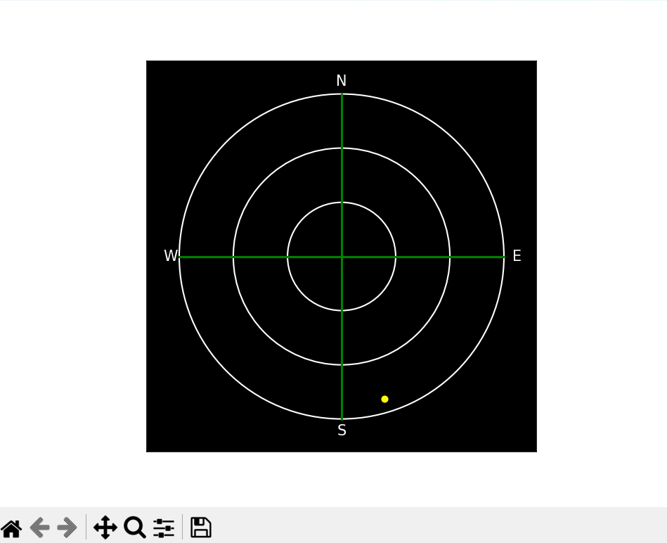

# Satellite Network Project

A Python application that tracks Starlink satellites and simulates how satellite elevation affects network performance. It uses orbital data from CelesTrak, calculates satellite positions with Skyfield, and displays the results in an interactive desktop dashboard.

**Satellite positions use real orbital data. Latency, throughput, and packet loss are simulated, not measured from the Starlink network.**



## Features

- Downloads current Starlink Two-Line Element (TLE) data from CelesTrak.
- Calculates satellite elevation and azimuth relative to a ground observer.
- Generates a 24-hour dataset at one-minute intervals.
- Simulates latency, throughput, and packet loss based on satellite elevation.
- Displays elevation-versus-latency and elevation-versus-throughput charts.
- Includes an animated sky view with a UTC clock and visible satellite count.
- Exports results to CSV for further analysis.

## Technologies

- Python
- Skyfield
- Requests
- Pandas
- NumPy
- Matplotlib
- Tkinter

## Getting Started

### 1. Clone the repository

```bash
git clone https://github.com/Tenthship/SatelliteNetworkProject.git
cd SatelliteNetworkProject
```

### 2. Create a virtual environment

```bash
python -m venv .venv
```

Activate it on Windows PowerShell:

```powershell
.\.venv\Scripts\Activate.ps1
```

Or on macOS/Linux:

```bash
source .venv/bin/activate
```

### 3. Install dependencies

```bash
python -m pip install requests skyfield pandas numpy matplotlib
```

Tkinter must also be available in your Python installation. Check it with:

```bash
python -m tkinter
```

If it is missing, install your operating system's Python/Tk package or use a Python installation that includes it.

### 4. Run the application

```bash
python main.py
```

Run this command from the repository directory with an internet connection.

The application generates the dataset before opening the dashboard, so the window may take a moment to appear. Each run refreshes `TLE.txt` after a successful download and overwrites `satellite_network_dataset.csv`.

## Dashboard

### Performance Charts

Two scatter plots display the simulated relationship between:

- Satellite elevation and latency.
- Satellite elevation and throughput.

These charts use the generated 24-hour dataset.

### Live Sky View

The sky view recalculates satellite positions for the current time approximately every 200 milliseconds.

- **Yellow dots:** Satellites at or above the horizon.
- **Gray dots:** Satellites below the horizon, displayed on the outer ring.
- **Center:** Directly overhead.
- **Outer ring:** The horizon.

The display also shows the current UTC time and the number of visible satellites.

The live sky view uses the current time; it does not play back the generated dataset.

## Configuration

Modify these values near the top of `main.py`:

```python
NUM_SATELLITES = 20
lat, lon, elev_m = 32.85548069219173, -117.20414146258183, 111
CSV_FILE_NAME = "satellite_network_dataset.csv"
```

| Setting | Description |
| --- | --- |
| `NUM_SATELLITES` | Number of satellites read from the beginning of the TLE file. |
| `lat` | Observer latitude in degrees. |
| `lon` | Observer longitude in degrees. |
| `elev_m` | Observer elevation above sea level in meters. |
| `CSV_FILE_NAME` | Output CSV filename. |

The default observer is in the San Diego area.

The application selects the first satellites in the downloaded file, so some or all may be below the observer's horizon at a given time. `NUM_SATELLITES` must not exceed the number available in the file.

## Network Simulation

For satellites at or above the horizon, network metrics are modeled using elevation in degrees:

```text
Latency (ms) = 25 + (90 - elevation) × 0.5 + random integer from -5 to 5

Throughput (Mbps) = 200 - (90 - elevation) × 1.5 + random integer from -20 to 20

Packet loss (%) = max(0, (20 - elevation) × 0.3 + random integer from -1 to 1)
```

Throughput is clamped between 0 and 1,000 Mbps.

For satellites below the horizon:

- Latency is left empty.
- Throughput is set to 0 Mbps.
- Packet loss is set to 100%.

This simplified model illustrates how elevation could relate to connection quality. It does not account for congestion, weather, ground station routing, or satellite handoffs. Random variation causes results to differ between runs.

## CSV Output

With the default settings, each run produces **28,800 rows**: 20 satellites sampled at 1,440 timestamps.

| Column | Description |
| --- | --- |
| `time` | UTC timestamp. |
| `name` | Satellite name from the TLE data. |
| `altitude` | Elevation angle above the observer's horizon in degrees, not orbital height. |
| `azimuth` | Compass direction in degrees, measured clockwise from north. |
| `latency` | Simulated latency in milliseconds; empty below the horizon. |
| `throughput_mbps` | Simulated throughput in Mbps. |
| `packet_loss_percent` | Simulated packet loss percentage. |

## Repository Files

| File | Purpose |
| --- | --- |
| `main.py` | Data download, orbital calculations, network simulation, CSV export, and dashboard. |
| `TLE.txt` | Starlink orbital elements, refreshed after a successful download. |
| `satellite_network_dataset.csv` | Generated satellite positions and simulated network metrics. |

## Data Source

Starlink orbital elements are provided by [CelesTrak](https://celestrak.org/NORAD/elements/gp.php?GROUP=starlink&FORMAT=tle).